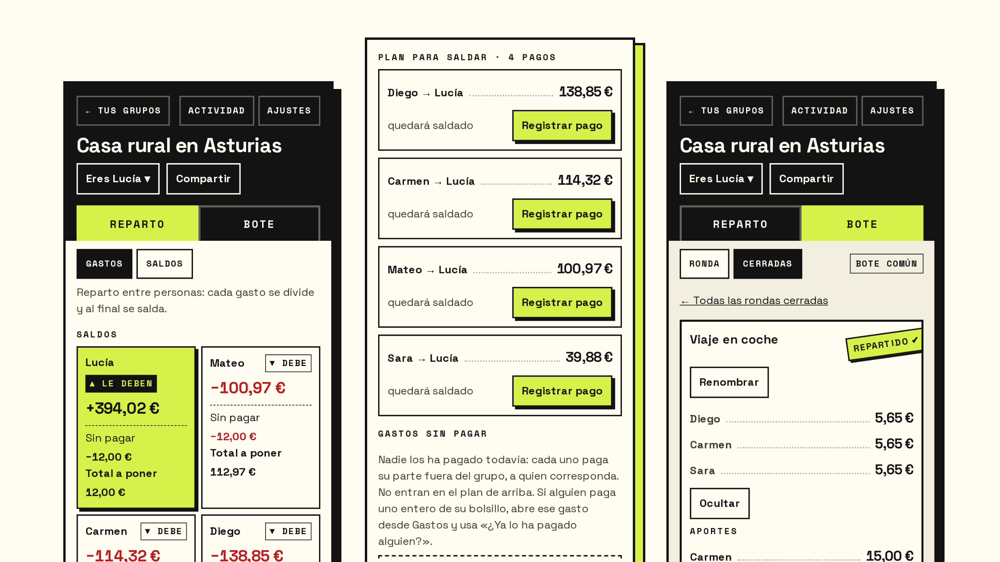
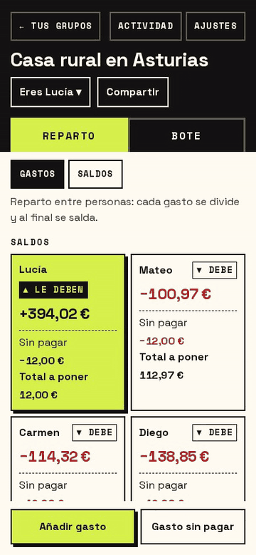
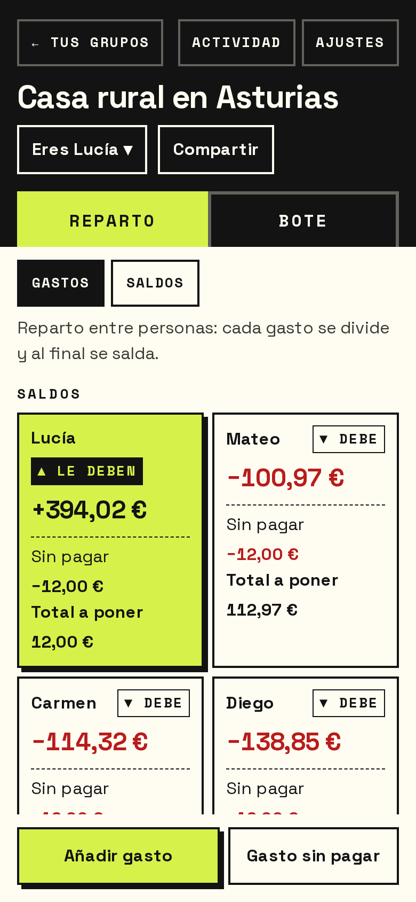
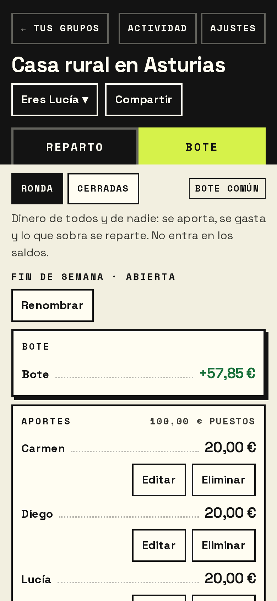
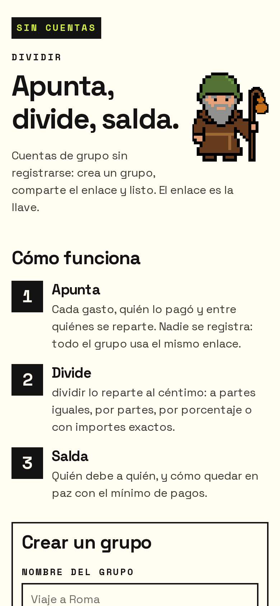
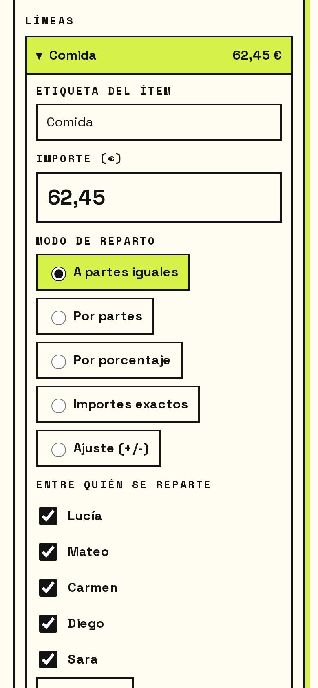
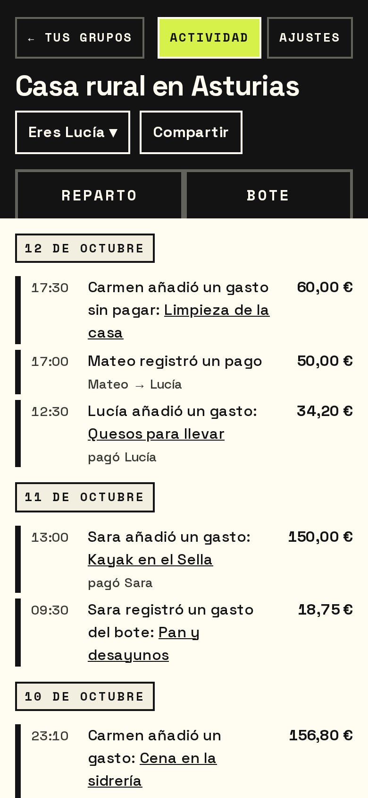
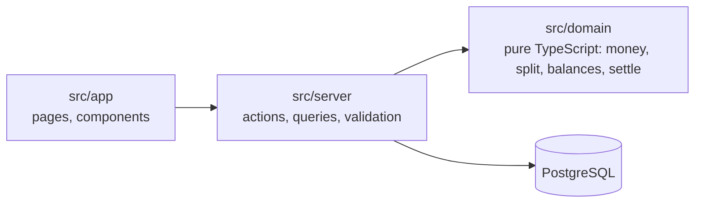

<div align="center">

<h1>
  <picture>
    <source media="(prefers-color-scheme: dark)" srcset="docs/screenshots/banner-dark.png">
    
  </picture>
</h1>

**Split group expenses to the cent. Settle up in the fewest possible payments.**<br>
No accounts, no app to install: create a group, share the link, done.

[](https://github.com/patatapython/dividir/actions/workflows/ci.yml)


[](LICENSE)

[**Live app →**](https://dividir.pollolist.app) · [Two modes](#two-ways-to-share-money-reparto-and-bote) · [Features](#features) · [Engineering](#under-the-hood) · [Run it locally](#run-it-locally)



</div>

dividir is a mobile-first web app for the money a group shares: a trip, a shared flat, a
weekend in a rural house. Everyone opens the same link, writes down what they paid, and
the app tells each person where they stand and the shortest way to get everyone even.
Built for a real group of nearly 30 friends, who use it in production.

> The interface is in Spanish (it was built for a Spanish group). An English UI is on the
> roadmap.

## See it in action



Lucía's group is back from Asturias. Someone adds the churros they forgot to log:

1. **Añadir gasto** — a concept and an amount; by default it is split equally.
2. **Guardar** — every balance updates at once, to the cent.
3. **Saldos** — the plan to settle up is recomputed: four payments, all to Lucía, and
   nobody pays twice.

Every amount is stored in integer cents. Splitting 10 € between three people gives
3,34 + 3,33 + 3,33, and the extra cent always goes to the same person for the same input.

<br clear="right">

## Two ways to share money: Reparto and Bote

Most expense splitters model one thing: debts between people. Real groups also do
something else, especially in Spain: everyone puts cash into a **bote** (a kitty) and
the drinks, the ice and the bread are paid from it. That money belongs to nobody, and
nobody owes anybody for it. dividir keeps the two apart, each in its own tab, because
mixing them is how group accounts stop adding up.

<table>
  <tr>
    <th width="50%">Reparto — expenses between people</th>
    <th width="50%">Bote — a shared kitty</th>
  </tr>
  <tr>
    <td valign="top">Someone pays, and the expense is split among the people it was for.</td>
    <td valign="top">Everyone chips in first; shared costs are paid from the kitty.</td>
  </tr>
  <tr>
    <td valign="top">Creates debts between people: Mateo owes Lucía.</td>
    <td valign="top">Creates no debt at all: the money is the group's.</td>
  </tr>
  <tr>
    <td valign="top">Ends with a <b>settlement plan</b>: the fewest payments that leave everyone even.</td>
    <td valign="top">Ends by <b>closing the round</b>: see what is left over, or share it out in proportion to what each person put in.</td>
  </tr>
  <tr>
    <td valign="top">For the rent, the dinner, the fuel.</td>
    <td valign="top">For a night out, a weekend, a group celebration.</td>
  </tr>
  <tr>
    <td valign="top"></td>
    <td valign="top"></td>
  </tr>
</table>

The kitty never enters the balances, so a round can be opened, spent, closed and
shared out without touching who owes whom.

## Features

<table>
  <tr>
    <td width="33%" valign="top"><br><b>Ten seconds to start</b><br>A name for the group and who is in it. No sign-up: the link is the key, and anyone who has it is in.</td>
    <td width="33%" valign="top"><br><b>Five ways to split</b><br>Equally, by shares, by percentage, exact amounts or adjustments, per line of the receipt, with several payers.</td>
    <td width="33%" valign="top"><br><b>A full activity log</b><br>Who added, edited or deleted what and when, with the previous amount on every edit.</td>
  </tr>
</table>

Also: a QR code to share the group, drawn on the device; refunds; CSV export whose
totals match the balances to the cent; "who are you" per device; and a landing page that
remembers your groups on this device only.

## Under the hood

| Concern | Approach |
|---|---|
| **Exact money** | Integer cents everywhere, never floats. One function, `allocate()` (largest remainder method with a deterministic tie-break), is the only place in the system where rounding happens. |
| **Optimal settlement** | For up to 16 people with open balances, an exact search over zero-sum subgroups (bitmask dynamic programming) finds the minimum number of payments. Beyond that, a greedy fallback. Both are exported and compared in property tests. |
| **The link is the key** | Groups are identified by a 24-character random id, and every query for a sub-entity is scoped by the group from the URL. Pages under `/g/` are sent with `noindex` and `no-referrer`. |
| **Safe under concurrency** | Every mutation runs in one transaction with row locks (`SELECT … FOR UPDATE`), so ten phones editing the same group cannot overspend the kitty or over-refund an expense. |
| **Clean layering** | `src/app → src/server → src/domain`, enforced by ESLint. The domain is pure TypeScript with no Next, React, Prisma or Node imports. |
| **Accessible** | Every color pair in `docs/design/contrast-pairs.json` is measured against WCAG AA by a script in CI, not eyeballed. 44 px touch targets, focus management for dialogs and lists, and a heading outline checked on every main screen by the E2E suite. |

### Tested like it handles money, because it does

- **Property-based tests** (fast-check) for the domain invariants: parts always add up to
  the total, balances always sum to zero, settlement zeroes every balance in at most
  *m − 1* payments, and the exact plan is never longer than the greedy one.
- **Integration tests** for every server action against a real PostgreSQL, including race
  tests that run conflicting writes at the same moment.
- **End-to-end tests** (Playwright) on the production build, on desktop and mobile
  viewports.
- **A scale simulation** that drives six months of a 30-person group through the server
  actions and checks the results against an independent oracle that reads the raw rows.

## Tech stack

Next.js 16 (App Router, Server Actions) · React 19 · TypeScript (strict) · Prisma 7 ·
PostgreSQL 17 · Zod · Vitest + fast-check · Playwright · Docker.



## Run it locally

Prerequisites: **Node 22** (pinned in `.nvmrc`; npm refuses other versions) and
**Docker** with the compose plugin.

```bash
npm ci
docker compose up -d db     # Postgres on host port 5433
npx prisma migrate deploy   # apply the migrations
npx prisma generate         # generate the Prisma client into src/generated/
npm run dev                 # http://localhost:3000
```

Every setting has a working local default, so no `.env` is needed. To override one,
copy `.env.example` to `.env`. Port 5433 is used for Postgres because 5432 is often
taken by a system install.

### Tests

```bash
npm run test:unit                 # unit and property tests
npm run test:int                  # integration tests (needs the database above)
npx playwright install chromium   # once, before the first E2E run
npm run test:e2e                  # Playwright on the production build
npm run verify                    # the full gate: typecheck, lint, unit, integration, E2E
npm run contrast                  # WCAG AA contrast of every color pair (Python 3)
```

## Self-hosting

The app ships as one Docker image (the `Dockerfile`, non-root, with a healthcheck) plus
PostgreSQL. `compose.prod.yml` is the production setup of the live app: the app, the
database and a one-off migration step, behind a Traefik reverse proxy that terminates TLS
and reaches the app over an external Docker network. To host it yourself, point that
network at your own proxy and provide `POSTGRES_USER` and `POSTGRES_PASSWORD`. Keep
`TRUST_PROXY=1` only if your proxy overwrites `X-Forwarded-For`; otherwise the rate
limiter would trust a header the client can forge.

## Roadmap

- English interface (i18n).

## License

[MIT](LICENSE)
